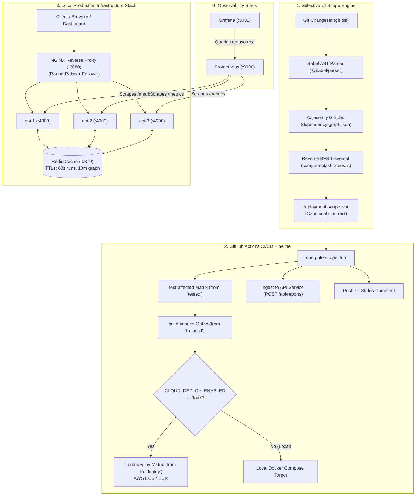

# 💥 BlastRadius 2.0: Selective Monorepo CI/CD & Distributed Container Infrastructure

[](https://github.com)
[](https://opensource.org/licenses/MIT)
[](https://nodejs.org)
[](https://docker.com)
[](https://prometheus.io)
[](https://grafana.com)

**BlastRadius 2.0** connects static AST dependency analysis and reverse breadth-first search (BFS) selective CI testing to a production-grade, containerized infrastructure: an Express API cluster with deterministic replica identity, Redis distributed caching with graceful offline degradation, NGINX round-robin load balancing with passive failover, provisioned Prometheus/Grafana observability, an automated GitHub Actions matrix pipeline, and optional AWS ECS Fargate deployment via Terraform.

- **Repository:** [https://github.com/GOVINDRAJ17/BlastRadius](https://github.com/GOVINDRAJ17/BlastRadius)
- **Production Dashboard:** [https://blastradius-dashboard-ctxdz9bwe.vercel.app](https://blastradius-dashboard-ctxdz9bwe.vercel.app)

---

## 📑 Table of Contents
1. [Architectural Overview](#1-architectural-overview)
2. [Technology Stack](#2-technology-stack)
3. [Deployment-Scope Contract (Phase 1)](#3-deployment-scope-contract-phase-1)
4. [Monorepo Service Topology](#4-monorepo-service-topology)
5. [Quick Start & Local Setup](#5-quick-start--local-setup)
6. [API Service & Distributed Redis Caching](#6-api-service--distributed-redis-caching)
7. [NGINX Load Balancing & Passive Failover Demo](#7-nginx-load-balancing--passive-failover-demo)
8. [Prometheus & Grafana Monitoring](#8-prometheus--grafana-monitoring)
9. [GitHub Actions Dynamic CI/CD Pipeline](#9-github-actions-dynamic-cicd-pipeline)
10. [Optional Cloud Deployment (AWS ECS via Terraform)](#10-optional-cloud-deployment-aws-ecs-via-terraform)
11. [Dashboard & Data-Source Indicators](#11-dashboard--data-source-indicators)
12. [Troubleshooting & Verification](#12-troubleshooting--verification)

---

## 1. Architectural Overview



---

## 2. Technology Stack

| Layer | Technologies & Tools |
| :--- | :--- |
| **Monorepo Engine** | Node.js 22, `@babel/parser`, `@babel/traverse`, Git CLI, AST graph builder |
| **API Cluster** | Node.js Express 4, `ioredis`, `prom-client`, `cors`, `express-rate-limit` |
| **Caching Layer** | Redis 7.2 (Alpine), key namespace `blastradius:<area>:<id>`, cache-aside |
| **Load Balancer** | NGINX 1.25 (Alpine), passive health checks, `proxy_next_upstream` retry |
| **Observability** | Prometheus v2.51, Grafana 10.4 (provisioned datasources & dashboards) |
| **Container Runtime** | Docker Engine 28, Docker Compose v2, Alpine-based Node 22 images |
| **CI/CD** | GitHub Actions with dynamic matrix strategy (`fromJson`), OIDC AWS auth |
| **Cloud IaC (Optional)**| Terraform 1.7+, AWS ECS Fargate, ECR, Application Load Balancer, ElastiCache |
| **Database & Dashboard**| Supabase (PostgreSQL), Vercel serverless functions, Vis-Network graph |

---

## 3. Deployment-Scope Contract (Phase 1)

All downstream build, test, deploy, and visualization workflows consume a unified, immutable JSON contract: `deployment-scope.json`:

```json
{
  "commit_sha": "a1b2c3d...",
  "base_ref": "master",
  "changed_files": ["services/auth/index.js"],
  "changed_services": ["auth"],
  "directly_affected": ["auth"],
  "transitively_affected": ["payments", "notifications"],
  "tested": ["auth", "payments", "notifications"],
  "to_build": ["auth", "payments", "notifications"],
  "to_deploy": ["auth", "payments", "notifications"],
  "skipped": ["api", "search", "shared"],
  "full_rebuild": false,
  "full_rebuild_reason": null,
  "causal_paths": {
    "auth": "Directly modified in git diff (services/auth/index.js)",
    "payments": "Tested transitively because payments -> auth",
    "notifications": "Tested transitively because notifications -> payments -> auth"
  }
}
```

### Scope Invariants
1. **Single Source of Truth**: `to_build` and `to_deploy` are strictly derived from the same affected set (`tested`). Logic is never duplicated across jobs.
2. **Deterministic Full Rebuild**: Triggered if `services/shared/` or root files (`package.json`, root Dockerfiles) are touched, or if the git diff base ref cannot be resolved.
3. **Empty-Set Handling**: If non-service files (e.g. documentation) change, `tested: []` and `has_affected: false` prevent matrix failures.

---

## 4. Monorepo Service Topology

```
                  [shared] (core utility)
                 /    |    \
                /     |     \
               v      v      v
            [auth]    |      |
              |       |      |
              v       v      |
           [payments]        |
              |              |
              v              v
          [notifications] <--+

          [search] (isolated standalone)
          [api] (containerized telemetry & report service)
```

| Service | Category | Dependencies | Downstream Dependents | Responsibility |
| :--- | :--- | :--- | :--- | :--- |
| **`shared`** | Core Utility | _None_ | `auth`, `payments`, `notifications` | Currency formatting, email regex, structured logger |
| **`auth`** | Core Domain | `shared` | `payments` | JWT generation and cryptographic verification |
| **`payments`**| Core Domain | `auth`, `shared` | `notifications` | Transaction authorization and ledger processing |
| **`notifications`**| Edge Domain | `payments`, `shared` | _None_ | Payment receipt dispatch & email delivery |
| **`search`** | Standalone | _None_ | _None_ | Product catalog query engine & indexer |
| **`api`** | Telemetry / CI | _None_ | Monorepo consumers | Health, metrics, runs cache, report ingestion |

---

## 5. Quick Start & Local Setup

### Prerequisites
- **Node.js** >= 22.0.0
- **Docker Desktop** (with Compose v2)
- **PowerShell** (Windows) or **bash** (Linux/macOS)

### 1. Clone & Install
```powershell
git clone https://github.com/GOVINDRAJ17/BlastRadius.git
cd BlastRadius
npm install
```

### 2. Run All Monorepo Unit Tests (Zero External Dependencies)
```powershell
npm run test:all
```
*Executes all 24 native tests across `services/*/test/*.test.js`.*

### 3. Build Dependency Graph & Compute Blast Radius
```powershell
# Generate static AST dependency graph
npm run graph

# Test simulated changes:
npm run blast-radius -- --files "services/search/index.js"
npm run blast-radius -- --files "services/auth/index.js"
npm run blast-radius -- --files "services/shared/index.js"
```

### 4. Start Local Containerized Infrastructure
Ensure Docker Desktop is running, then launch the Compose stack:

```powershell
# Copy local environment variables template
Copy-Item .env.example .env

# Build and start all containers in detached mode
docker compose up -d --build
```

Verify that all services report healthy status:
```powershell
docker compose ps
```

---

## 6. API Service & Distributed Redis Caching

### Replica Identity Design Choice
Rather than running generic anonymous scaling (`docker compose up --scale api=3`), BlastRadius explicitly provisions three instances (`api-1`, `api-2`, `api-3`) sharing the identical base image and differing only by an explicit `INSTANCE_ID` environment variable:
- Guaranteed deterministic replica identification across logs, Prometheus labels, and NGINX `X-Served-By` response headers.
- Independent heartbeat tracking in Redis (`blastradius:heartbeat:api-N`) allowing fine-grained health inspection.

### API Endpoints Reference

| Method | Path | Auth | Purpose | Response Example |
| :--- | :--- | :---: | :--- | :--- |
| `GET` | `/health` | Public | Liveness probe & instance identity | `{"status":"ok","instance_id":"api-1","uptime":120.5}` |
| `GET` | `/ready` | Public | Readiness probe checking Redis connectivity | `{"ready":true,"redis":"connected"}` |
| `GET` | `/metrics` | Public | Prometheus text metrics (`prom-client`) | `http_requests_total{instance="api-1"} 42` |
| `GET` | `/api/runs` | Public | Recent CI runs list (cache-first via Redis) | `{"source":"redis","runs":[...]}` |
| `GET` | `/api/runs/:id` | Public | Single run details with scope contract | `{"id":"104","scope":{...}}` |
| `GET` | `/api/infra/status`| Public | Replica heartbeats and container health | `{"active_replicas":3,"replicas":[...]}` |
| `GET` | `/api/deployments`| Public | Deployment history | `{"deployments":[...]}` |
| `POST`| `/api/reports` | Bearer | Authenticated ingestion of CI reports | `{"status":"ingested","id":"run-..."}` |

### Resilient Degradation
The API features automatic fallback: if Redis goes offline or restarts, the API logs a warning, falls back to disk-based JSON reads, and continues serving requests without crashing.

---

## 7. NGINX Load Balancing & Passive Failover Demo

The NGINX reverse proxy (`http://localhost:8080`) load balances incoming HTTP traffic across `api-1`, `api-2`, and `api-3` using a round-robin upstream pool:

```nginx
upstream api_cluster {
    server api-1:4000 max_fails=2 fail_timeout=5s;
    server api-2:4000 max_fails=2 fail_timeout=5s;
    server api-3:4000 max_fails=2 fail_timeout=5s;
}
```

> **Note on NGINX Health Checks:** Open-source NGINX uses passive health monitoring (`max_fails` / `fail_timeout`) triggered during real client traffic. If a replica fails or times out, `proxy_next_upstream` transparently retries the request against the next replica before returning a response, guaranteeing zero 5xx client errors.

### Running the Failover Demo Script

Execute the automated test script to observe live traffic distribution, stop `api-2`, verify seamless failover, and witness self-healing upon restart:

**PowerShell:**
```powershell
powershell -File scripts/demo-failover.ps1
```

**Bash:**
```bash
chmod +x scripts/demo-failover.sh
./scripts/demo-failover.sh
```

**Demo Workflow:**
1. Sends 30 requests to `http://localhost:8080/health` and tallies `X-Served-By` headers across `api-1`, `api-2`, and `api-3` (~10 requests each).
2. Executes `docker compose stop api-2`.
3. Sends 30 subsequent requests. Confirms **zero 5xx errors** and verifies traffic distributes exclusively between `api-1` and `api-3` (~15 requests each).
4. Inspects `/api/infra/status` confirming `api-2` is marked offline.
5. Executes `docker compose start api-2` and verifies it automatically resumes receiving traffic.

---

## 8. Prometheus & Grafana Monitoring

### Prometheus Setup
- Accessible at: **`http://localhost:9090`**
- Scrapes `/metrics` from all three API replicas every 5 seconds.
- Exposed metrics:
  - `http_requests_total` (labels: `method`, `route`, `status_code`, `instance`)
  - `http_request_duration_seconds` (latency histogram with p50, p90, p95, p99 quantiles)
  - `ci_runs_total` (counter of processed CI runs)

### Provisioned Grafana Dashboard
- Accessible at: **`http://localhost:3001`**
- Default credentials: `admin` / `admin` (change prompted on first login).
- Fully automated file-based provisioning (`infrastructure/grafana/provisioning/`):
  - Pre-configured Prometheus datasource (`http://prometheus:9090`).
  - Pre-loaded **"BlastRadius 2.0 - System & Infrastructure Overview"** dashboard:
    - **Request Rate by Instance**: Real-time stacked ops/sec across replicas.
    - **p95 Latency**: 95th-percentile response time.
    - **5xx Error Rate**: Monitored failover indicator.
    - **Healthy Replicas Count**: Instant `up` gauge.
    - **Total CI Runs Ingested**: Lifetime run counter.

---

## 9. GitHub Actions Dynamic CI/CD Pipeline

The workflow [`.github/workflows/blastradius.yml`](file:///.github/workflows/blastradius.yml) executes four distinct phases:

1. **`compute-scope`**:
   - Performs a complete git diff (`fetch-depth: 0`).
   - Runs `build-graph.js` and `compute-blast-radius.js`.
   - Generates and uploads `deployment-scope.json` as a build artifact.
   - Ingests the report into the API service via authenticated `POST /api/reports`.
   - Publishes an impact summary comment directly onto the pull request.
2. **`test-affected`**:
   - Dynamically spawns parallel Docker test containers **only** for services in `tested`:
     ```yaml
     strategy:
       matrix:
         service: ${{ fromJson(needs.compute-scope.outputs.tested) }}
     ```
   - Guarded by `if: needs.compute-scope.outputs.has_affected == 'true'` so empty changesets skip gracefully.
3. **`build-images`**:
   - Builds production images tagged with the full commit SHA (`${{ github.sha }}`) **only** for services in `to_build`.
4. **`cloud-deploy`**:
   - Deploys **only** services in `to_deploy` to AWS ECS Fargate via OIDC auth.
   - Gated by `if: vars.CLOUD_DEPLOY_ENABLED == 'true'`.

---

## 10. Optional Cloud Deployment (AWS ECS via Terraform)

To maintain a strict local-first architecture, all cloud resources are **optional** and gated by configuration (`CLOUD_DEPLOY_ENABLED=false`).

Complete Infrastructure-as-Code definitions are located in [`infrastructure/terraform/`](file:///infrastructure/terraform/):
- **`main.tf`**: AWS VPC, ECS Fargate cluster, Amazon ECR repositories, Application Load Balancer (ALB), ElastiCache Redis replication group, and CloudWatch Log Groups.
- **`variables.tf`**: Configurable parameters (`aws_region`, `environment`, `vpc_cidr`).
- **`outputs.tf`**: ALB DNS name, ECR repository URLs, and ECS cluster ID.

### Deploying to AWS (When Enabled)
```powershell
cd infrastructure/terraform
terraform init
terraform plan -out=tfplan
terraform apply tfplan
```

---

## 11. Dashboard & Data-Source Indicators

The BlastRadius dashboard at [`dashboard/index.html`](file:///dashboard/index.html) or [live on Vercel](https://blastradius-dashboard-ctxdz9bwe.vercel.app) displays real-time telemetry, interactive dependency topology, and Phase 1 scope contracts.

### Data-Source Labeling Standard
In adherence to the **Real Data Only** constraint, every card and value on the dashboard is explicitly marked:

| Badge / Label | Meaning |
| :--- | :--- |
| **`LIVE API (DOCKER)`** | Data queried live from local Compose API (`http://localhost:8080/api/infra/status`). |
| **`CONTRACT / LAST-RUN`** | Real historical data from the most recent git changeset or CI run artifact. |
| **`SIMULATED`** | Interactive demo scenario fixture (e.g. `auth changed`, `search changed`). Clearly labeled in the selector and banners. |
| **`UNAVAILABLE`** | Live backend or container metrics are unreachable or offline. No fabricated numbers are displayed. |

### Savings Formula
When application services are affected:
$$\text{Time Saved (minutes)} = (\text{Total Application Services [5]} - \text{Tested Services}) \times 2.5\text{ minutes}$$
$$\text{Percent Saved} = \frac{\text{Total Application Services [5]} - \text{Tested Services}}{\text{Total Application Services [5]}} \times 100\%$$

When no application services are affected (zero-change or non-runtime changes):
$$\text{Time Saved} = 0\text{ minutes}, \quad \text{Percent Saved} = \text{N/A (no tests required)}$$

---

## 12. Troubleshooting & Verification

### Common Issues & Solutions

1. **Windows CRLF Line Endings**:
   - *Problem*: Linux containers fail with `\r: command not found` when executing shell scripts or reading NGINX configurations.
   - *Solution*: `infrastructure/nginx/nginx.conf` and `scripts/demo-failover.sh` are saved with Unix LF line endings. Git handles this via `.gitattributes`.

2. **Docker Desktop Engine Named Pipe Access**:
   - *Problem*: `error during connect: open //./pipe/dockerDesktopLinuxEngine: The system cannot find the file specified`.
   - *Solution*: Start Docker Desktop from the Windows Start Menu and ensure the engine has completed initializing before running `docker compose up`.

3. **Port Conflicts**:
   - `8080` (NGINX Proxy), `9090` (Prometheus), `3001` (Grafana), `4000` (Local API dev).
   - If a port is occupied by another local service, change the mapped host port in `docker-compose.yml`.

4. **Redis Cache Offline**:
   - The Express API automatically recovers when Redis is offline and logs a warning. Restart Redis with `docker compose restart redis`.

---

## 📄 License
MIT License. Built for engineering rigor, monorepo performance, and developer velocity.
